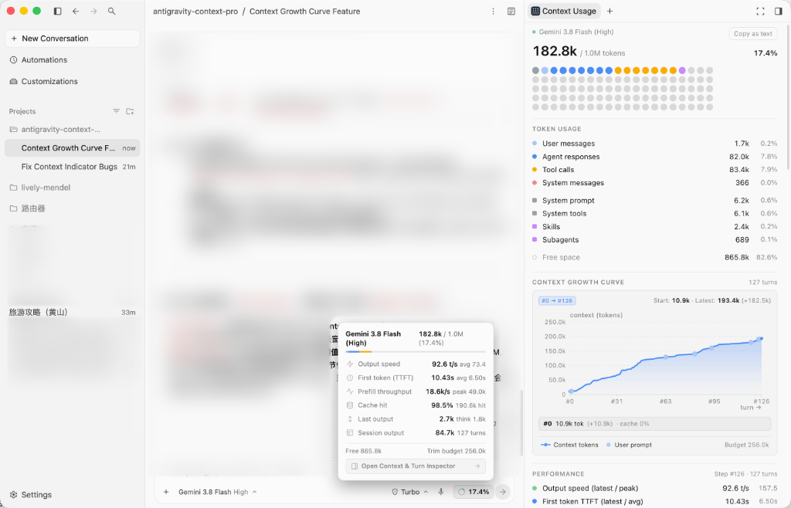

# Antigravity Context Pro

**English** | [简体中文](README_ZH.md)

A context window monitor and generation telemetry inspector for the **Antigravity 2.0** desktop app (macOS, Windows, and Linux). It combines an **input-box context mini-ring** with a **side-panel context & per-turn call inspector**.

> [!NOTE]
> **Upstream Attribution**
> This project is forked from [`dimitr-io/antigravity-desktop-context`](https://github.com/dimitr-io/antigravity-desktop-context) (Copyright © 2026 Dimitrios Ioannidis, [MIT License](LICENSE)) and extended with secondary development.



---

## Features

- **Input Box Context Mini-Ring & Telemetry Popover**
  - Embeds a live context usage ring (`%`) directly into the chat input toolbar next to the send button.
  - Clicking the ring opens a compact popover showing **Output speed (`t/s`)**, **First token latency (`TTFT`)**, **Prefill throughput**, **Cache hit rate**, **Last turn output**, and **Session output**, plus a one-click button to open the side panel.
- **Interactive Context Growth Curve (Tokens vs. Turn)**
  - Live SVG curve plotting context accumulation over conversation turns (horizontal axis: `turn`, vertical axis: `context`).
  - Highlights user prompt turns, cache efficiency, and compaction drops.
  - Interactive crosshair inspection and one-click navigation to jump straight into that turn's detailed breakdown.
- **Per-Turn Call Inspector (DeepSeek Harness Style)**
  - Click any turn row under **Recent turns** in the side panel to expand its full telemetry breakdown:
    - **Context & Prefill**: Total prompt tokens, cache read vs. fresh input split, context delta (`+tok`), and prefill throughput.
    - **Output & Latency**: Thinking vs. response token split, TTFT, streaming duration, total duration, and generation speed.
    - **Tool Call Token Bill**: Every tool invoked in that turn (`read_file`, `edit_file`, `run_command`, etc.) with its target file/command summary and exact context token cost.
    - **Snippets**: Previews of the user prompt, chain-of-thought reasoning, and response text for that turn.
- **Exact Context Breakdown**
  - Reads the native SQLite/Protobuf records (`steps` and `gen_metadata`) written by Antigravity 2.0—matching `agy /context` with zero extra token overhead.
  - Displays a 100-dot usage grid, token usage by category, active checkpoints, and files in context.
- **Native Lifecycle (Zero Background Daemon)**
  - Runs inside Antigravity's built-in sidecar supervisor (`main.mjs`): starts automatically when Antigravity launches and exits immediately when Antigravity quits.

---

## Installation

Requires **Antigravity 2.0 Desktop** and **Python 3** on your `PATH` (`python3`, `python`, or `py`).

### 1. Clone into the Antigravity plugins directory

**macOS / Linux**
```bash
git clone https://github.com/pigzzz104/antigravity-context-pro.git ~/.gemini/config/plugins/desktop-context
```

**Windows (PowerShell)**
```powershell
git clone https://github.com/pigzzz104/antigravity-context-pro.git "$HOME\.gemini\config\plugins\desktop-context"
```

### 2. Enable the plugin

1. Restart Antigravity 2.0.
2. Open **Customizations → Installed** and enable **Context Usage**.
3. The **Input Box Mini-Ring** will appear in the chat input bar automatically, and **Context Usage** will be available in the right-hand side panel (both via the ring popover and in the `+` New Tab menu).

---

## Enhancements Over Upstream

| Area | Upstream (`antigravity-desktop-context`) | This Fork (`antigravity-context-pro`) |
| :--- | :--- | :--- |
| **Chat Input Bar** | None (side panel only) | Live SVG context ring + floating telemetry popover |
| **Generation Telemetry** | Not collected | Output speed (`t/s`), TTFT, prefill throughput, cache hit % |
| **Turn History** | None | Clickable per-turn inspector with tool token bill & snippets |
| **Side Panel Access** | Hidden behind search unless manually pinned | Injected into the `+` New Tab list & linked from input ring popover |
| **Pinned Tab Sync** | Fails with `no-conversation` or freezes on old chat | Automatically tracks the active conversation in real time |
| **Outside-of-Project Mode** | Hangs indefinitely on `Loading…` (`getWorkspaceUris`) | Loads immediately (`< 200ms`) without blocking |
| **Tool Token Accounting** | Counts only argument bytes (`~32 tok`) for `read_file` | Includes full tool output payload bytes |

---

## CLI Usage & Testing

You can also run the parser directly from the terminal:

```bash
# Inspect the most recently active conversation
python3 sidecars/context/context_report.py

# Output structured JSON (including telemetry and per-turn details)
python3 sidecars/context/context_report.py --json

# Run unit tests
python3 -m unittest discover tests
```

## License

[MIT License](LICENSE) — Original work Copyright © 2026 Dimitrios Ioannidis (`dimitr-io/antigravity-desktop-context`); secondary development and enhancements licensed under MIT.
